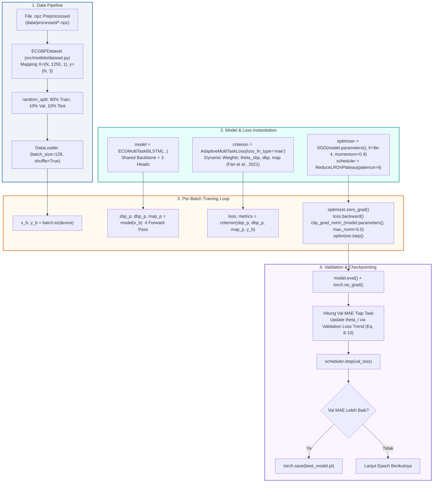
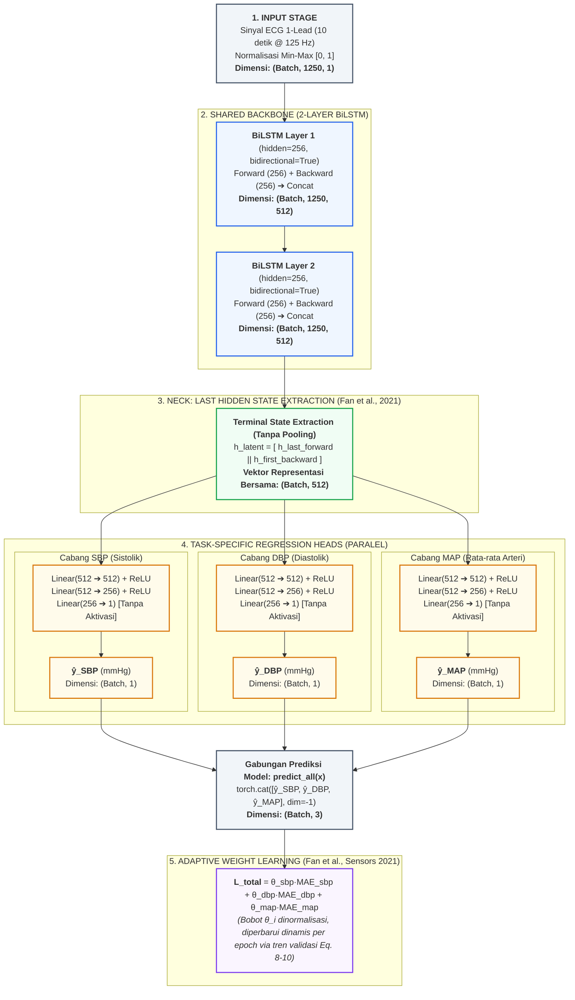

# Bimbingan Week 3: Perancangan Arsitektur Deep Learning & Evaluasi Estimasi Tekanan Darah

> **Dokumen Catatan & Tindak Lanjut Bimbingan Skripsi — Minggu ke-3**
> **Topik:** Estimasi Tekanan Darah Kontinu (SBP, DBP, MAP) Berbasis Sinyal Elektrokardiogram (ECG) Menggunakan Multi-Task BiLSTM dan Adaptive Loss.

---

## Daftar Isi

1. [Mengapa Sinyal Hasil Preprocessing Memulai Nilai di ~0.2?](#1-mengapa-sinyal-hasil-preprocessing-memulai-nilai-di-02)
2. [Paradigma Pemodelan: REGRESI Murni, BUKAN KLASIFIKASI](#2-paradigma-pemodelan-regresi-murni-bukan-klasifikasi)
3. [Metrik Evaluasi: &#34;Nilai Regresi Mendekati 1&#34; ($R^2$ &amp; Korelasi Pearson $r$)](#3-metrik-evaluasi-nilai-regresi-mendekati-1-r2--korelasi-pearson-r)
4. [Aktivasi Output Layer: Linear (Tanpa Fungsi Aktivasi)](#4-aktivasi-output-layer-linear-tanpa-fungsi-aktivasi)
5. [Blok-Blok Perancangan Arsitektur BiLSTM](#5-blok-blok-perancangan-arsitektur-bilstm)
6. [Penjelasan Mendalam: Multitask Learning (MTL)](#6-penjelasan-mendalam-multitask-learning-mtl)
7. [Penjelasan Mendalam: Adaptive Weight Learning](#7-penjelasan-mendalam-adaptive-weight-learning)
8. [Alur Kodingan Deep Learning (End-to-End Pipeline)](#8-alur-kodingan-deep-learning-end-to-end-pipeline)
9. [Visualisasi Perancangan Arsitektur Deep Learning](#9-visualisasi-perancangan-arsitektur-deep-learning)
10. [Uji Coba 1 Subjek (Sanity Check &amp; Single-Subject Validation)](#10-uji-coba-1-subjek-sanity-check--single-subject-validation)
11. [Panduan Pelatihan di AWS GPU (Cloud Training)](#11-panduan-pelatihan-di-aws-gpu-cloud-training)
12. [Daftar Pustaka (References) &amp; Hasil Audit Kesesuaian](#12-daftar-pustaka-references--hasil-audit-kesesuaian)

---

## 1. Mengapa Sinyal Hasil Preprocessing Memulai Nilai di ~0.2?

Pertanyaan ini muncul saat melihat visualisasi gelombang ECG hasil normalisasi Min-Max $[0, 1]$, di mana garis dasar awal (*resting baseline*) berada di sekitar amplitudo **0.2**, bukan **0.0**.

### Penjelasan Fisiologis dan Matematis:

1. **Efek Bandpass Filter (0.5 – 40 Hz):**

   * Filter Butterworth zero-phase (`scipy.signal.filtfilt`) mengeliminasi interferensi frekuensi rendah ($< 0.5\text{ Hz}$, yaitu *baseline wander* akibat pernapasan) dan komponen arus searah (DC Offset $0\text{ Hz}$).
   * Akibatnya, sinyal ECG berada dalam kondisi seimbang di sekitar garis isoelektrik: **tegangan saat istirahat jantung bernilai $\approx 0\text{ mV}$**.
2. **Morfologi Asimetris Gelombang ECG (P-Q-R-S-T):**

   * **Puncak Tertinggi:** Gelombang R (defleksi positif kuat akibat depolarisasi ventrikel), misalnya $x_{\max} \approx +1.2\text{ mV}$.
   * **Lembah Terendah:** Gelombang S atau Q (defleksi negatif ke bawah garis dasar), misalnya $x_{\min} \approx -0.3\text{ mV}$.
   * **Garis Istirahat (Isoelektrik / Segmen T–P):** Voltase saat otot jantung tidak berkontraksi berada di sekitar $0.0\text{ mV}$.
3. **Formula Min-Max Normalization $[0, 1]$ (Fan et al., 2021):**

   $$
   \text{ECG}_{\text{norm}} = \frac{x - x_{\min}}{x_{\max} - x_{\min} + \epsilon}
   $$

   Jika disubstitusikan nilai tipikal sinyal ECG terpusat:

   * Titik terendah gelombang S ($x = -0.3\text{ mV}$):
     $$
     \text{ECG}_{\text{norm}}(-0.3) = \frac{-0.3 - (-0.3)}{1.2 - (-0.3)} = \frac{0.0}{1.5} = \mathbf{0.0}
     $$
   * Titik puncak gelombang R ($x = +1.2\text{ mV}$):
     $$
     \text{ECG}_{\text{norm}}(+1.2) = \frac{1.2 - (-0.3)}{1.2 - (-0.3)} = \frac{1.5}{1.5} = \mathbf{1.0}
     $$
   * **Garis isoelektrik istirahat ($x = 0.0\text{ mV}$):**
     $$
     \text{ECG}_{\text{norm}}(0.0) = \frac{0.0 - (-0.3)}{1.2 - (-0.3)} = \frac{0.3}{1.5} = \mathbf{0.20}
     $$

> **Kesimpulan:** Nilai $0.0$ pada skala $[0, 1]$ **bukan** merupakan garis datar sinyal, melainkan batas bawah lembah gelombang S negatif. Karena garis isoelektrik berada di $0\text{ mV}$ di antara gelombang R positif dan gelombang S negatif, garis istirahat tersebut secara alami dan konsisten terpetakan pada rentang **$0.15 - 0.25$ (~0.2)**. Ini adalah karakteristik sinyal fisiologis yang valid.

---

## 2. Paradigma Pemodelan: REGRESI Murni, BUKAN KLASIFIKASI

Penegasan penting dari dosen pembimbing:

* **Bukan Klasifikasi:** Penelitian ini **tidak** memprediksi label diskrit atau kategori kesehatan, seperti:

  * ❌ *Class 0: Normal* ($\text{SBP} < 120$)
  * ❌ *Class 1: Elevated / Prehypertension* ($120 \le \text{SBP} < 130$)
  * ❌ *Class 2: Hypertension Stage 1* ($130 \le \text{SBP} < 140$)
  * ❌ *Class 3: Hypertension Stage 2* ($\text{SBP} \ge 140$)
* **Murni Regresi:** Model memetakan deret waktu ECG kontinu secara langsung ke **nilai tekanan darah kontinu** dalam satuan fisik milimeter air raksa ($\text{mmHg}$):

  $$
  \mathbf{x} \in \mathbb{R}^{1250 \times 1} \xrightarrow{f_\theta} [\hat{y}_{\text{SBP}}, \hat{y}_{\text{DBP}}, \hat{y}_{\text{MAP}}]^\top \in \mathbb{R}^3
  $$

  *(Contoh output model: $\text{SBP} = 124.6\text{ mmHg}, \text{DBP} = 81.2\text{ mmHg}, \text{MAP} = 95.7\text{ mmHg}$)*.

---

## 3. Metrik Evaluasi: "Nilai Regresi Mendekati 1" ($R^2$ & Korelasi Pearson $r$)

Instruksi dosen: *"Pastikan nilai regresi mendekati 1"*.
Dalam analisis regresi, kriteria evaluasi performa tidak menggunakan akurasi klasifikasi (%), melainkan metrik asosiasi dan dispersi error:

### A. Koefisien Determinasi ($R^2$ Score)

$$
R^2 = 1 - \frac{\sum_{i=1}^N (y_i - \hat{y}_i)^2}{\sum_{i=1}^N (y_i - \bar{y})^2} = 1 - \frac{\text{SS}_{\text{res}}}{\text{SS}_{\text{tot}}}
$$

* **Rentang Nilai:** $(-\infty, 1.0]$.
* **Target:** Mendekati **$1.0$**.
* **Interpretasi:** Jika $R^2 = 0.90$, artinya $90\%$ dari total variasi tekanan darah pada pasien dapat dijelaskan secara akurat oleh morfologi sinyal ECG yang dipelajari model.

### B. Koefisien Korelasi Pearson ($r$)

$$
r = \frac{\sum_{i=1}^N (y_i - \bar{y})(\hat{y}_i - \bar{\hat{y}})}{\sqrt{\sum_{i=1}^N (y_i - \bar{y})^2 \sum_{i=1}^N (\hat{y}_i - \bar{\hat{y}})^2}}
$$

* **Rentang Nilai:** $[-1.0, +1.0]$.
* **Target:** Mendekati **$+1.0$** (korelasi linier positif sempurna).

### C. Visualisasi Pembuktian (Scatter Plot $y = x$)

Pada laporan hasil pengujian (evaluasi test set), sajikan grafik **Scatter Plot Ground Truth ($x$-axis) vs Prediksi Model ($y$-axis)** yang dilengkapi garis diagonal ideal $y = x$:

* Semakin rapat sebaran titik data mengikuti garis merah putus-putus $y = x$, semakin dekat nilai $R^2$ dan $r$ ke angka **1.0**.

---

## 4. Aktivasi Output Layer: Linear (Tanpa Fungsi Aktivasi)

Layer proyeksi terakhir pada setiap task head adalah:

```python
nn.Linear(in_features=256, out_features=1)  # Linear murni, tanpa aktivasi
```

### Perbandingan dengan Fungsi Aktivasi Lain:

| Fungsi Aktivasi             |                                                                                               Rentang Output                                                                                               | Cocok untuk BP Regression? | Penjelasan Alasan                                                                                                                                                |
| :-------------------------- | :---------------------------------------------------------------------------------------------------------------------------------------------------------------------------------------------------------: | :-------------------------: | :--------------------------------------------------------------------------------------------------------------------------------------------------------------- |
| **Linear (Identity)** | $(-\infty, +\infty)$ | **Sangat Cocok (Standar)** | Memberikan kebebasan penuh bagi model untuk memetakan output ke skala nyata$\text{mmHg}$ ($60 - 200\text{ mmHg}$) tanpa pembatasan gradien. |                            |                                                                                                                                                                  |
| **Sigmoid**           |          $(0, 1)$       |     ❌**Tidak Cocok**     | Mengharuskan target BP dinormalisasi ke$[0, 1]$. Rentan mengalami *vanishing gradient* pada nilai ekstrem hipertensi/hipotensi.          |                            |                                                                                                                                                                  |
| **Softmax**           |                                                                                            $\sum = 1, (0, 1)$                                                                                            | ❌**Salah Paradigma** | Menghasilkan distribusi probabilitas kelas diskrit.**Hanya untuk klasifikasi**.                                                                            |
| **ReLU**              |                                                                                              $[0, +\infty)$                                                                                              |   ⚠️**Beresiko**   | Meskipun BP tidak pernah bernilai negatif, penempatan ReLU di output layer beresiko menyebabkan*dying neuron* jika gradien inisialisasi awal bernilai negatif. |

---

## 5. Blok-Blok Perancangan Arsitektur BiLSTM

Arsitektur model deep learning dirancang secara hierarkis ke dalam 4 blok fungsional:

### Blok 1: Input Sequence Representation

* **Input:** Segmen sinyal ECG 1-lead berdurasi 10 detik hasil normalisasi Min-Max $[0, 1]$ pada frekuensi sampling $125\text{ Hz}$.
* **Dimensi Tensor:** `[Batch_Size, Sequence_Length=1250, Input_Channels=1]`.

### Blok 2: Shared Spatiotemporal BiLSTM Encoder

* **BiLSTM Layer 1:**
  * 256 unit forward LSTM + 256 unit backward LSTM $\to$ 512 fitur gabungan per timestep.
* **BiLSTM Layer 2:**
  * 256 unit forward LSTM + 256 unit backward LSTM $\to$ 512 fitur gabungan per timestep (Tabel 1 Fan et al., 2021).
* **Mengapa BiLSTM?**
  * Sinyal elektrokardiogram memiliki dependensi waktu dua arah: pembacaan gelombang saat ini (misal segmen ST) bergantung pada depolarisasi sebelumnya (kompleks QRS) dan repolarisasi sesudahnya (gelombang T). BiLSTM menangkap konteks historis dan prospektif sekaligus.

### Blok 3: Ekstraksi State Terakhir (Last Hidden State Extraction)

* **Ekstraksi State Terminal (Tanpa Pooling):** Sesuai metodologi Fan et al. (2021), jaringan tidak menggunakan pooling layer (seperti pada CNN), melainkan mengambil representasi tersembunyi (*hidden state*) terminal dari lintasan maju dan lintasan mundur:
  $$
  \mathbf{h}_{\text{latent}} = [\mathbf{h}_{T}^{\text{forward}} \,\|\, \mathbf{h}_{1}^{\text{backward}}] \in \mathbb{R}^{512}
  $$
* **Dimensi Output Feature Vector:** `[Batch_Size, 512]`.

### Blok 4: Task-Specific FC Heads (3 Cabang Paralel)

Menggunakan rancangan 2 hidden layers sesuai acuan utama Fan et al. (2021) untuk memprediksi ketiga variabel hemodinamik:

* **Head 1 (SBP):** $\text{Linear}(512 \to 512) \to \text{ReLU} \to \text{Linear}(512 \to 256) \to \text{ReLU} \to \text{Linear}(256 \to 1)$
* **Head 2 (DBP):** Arsitektur identik $\to \hat{y}_{\text{DBP}} \in \mathbb{R}^1$
* **Head 3 (MAP):** Arsitektur identik $\to \hat{y}_{\text{MAP}} \in \mathbb{R}^1$

> **Catatan Penegasan Linear vs. ReLU:**
> Seluruh lapisan fisik pada *Task Heads* menggunakan layer perkalian bobot `nn.Linear`. Fungsi aktivasi non-linier **ReLU** dipasang khusus pada *hidden layers* ($512 \to 512$ dan $512 \to 256$) agar model mampu menangkap hubungan non-linier fisiologis jantung, sedangkan *output layer* ($256 \to 1$) dibiarkan **Linear murni (tanpa aktivasi)** untuk memproyeksikan nilai regresi tekanan darah kontinu dalam skala $\text{mmHg}$.

---

## 6. Penjelasan Mendalam: Multitask Learning (MTL)

### A. Apa itu Multitask Learning?

**Multitask Learning (MTL)** adalah paradigma pembelajaran mesin di mana sebuah model dilatih untuk menyelesaikan **beberapa tugas terkait secara bersamaan** dengan memanfaatkan representasi fitur bersama (*shared representation*).

Dalam skripsi ini, ketiga tugas tersebut adalah estimasi kontinu:

1. **Tugas 1:** Estimasi Tekanan Darah Sistolik (*Systolic Blood Pressure* / SBP)
2. **Tugas 2:** Estimasi Tekanan Darah Diastolik (*Diastolic Blood Pressure* / DBP)
3. **Tugas 3:** Estimasi Tekanan Arteri Rata-rata (*Mean Arterial Pressure* / MAP)

### B. Mengapa Menggunakan Multitask Learning pada ECG-BP?

Jika kita melatih 3 model terpisah (*Single-Task Learning* / STL), masing-masing model hanya akan memperhatikan fitur ECG yang berkorelasi dengan targetnya sendiri, mengabaikan fakta biologis bahwa SBP, DBP, dan MAP dihasilkan oleh satu sistem kardiovaskular yang sama.

Secara fisiologis dan hemodinamik, ketiga parameter terikat formula:

$$
\text{MAP} \approx \text{DBP} + \frac{1}{3}(\text{SBP} - \text{DBP})
$$

Keuntungan teoritis menggunakan Multitask Learning:

1. **Inductive Transfer / Inductive Bias:** Informasi yang dipelajari pada satu tugas (misal gelombang T yang mencerminkan fase diastolik) membantu tugas lain (MAP dan SBP) memahami dinamika elastisitas vaskular secara utuh.
2. **Efek Regularisasi Implisit:** Memprediksi 3 target sekaligus memaksa *Shared BiLSTM Encoder* menemukan representasi laten $\mathbf{h} \in \mathbb{R}^{512}$ yang relevan secara umum bagi seluruh siklus jantung. Ini mengurangi risiko model menghafal noise acak (*overfitting*) pada satu tugas saja.
3. **Efisiensi Komputasi & Memori:** Hanya dibutuhkan 1 kali *forward pass* pada BiLSTM untuk menghasilkan representasi fitur yang kemudian dicabangkan ke 3 kepala regresi sederhana.

### C. Pola Arsitektur: Hard Parameter Sharing

Pendekatan yang diterapkan adalah **Hard Parameter Sharing**:

* Lapisan ekstraksi fitur (BiLSTM Layer 1, BiLSTM Layer 2, dan Last Hidden State) **dimiliki bersama 100%** oleh ketiga tugas.
* Lapisan atas (*Heads*) dipisahkan secara independen untuk memberikan fleksibilitas regresi non-linier khusus bagi rentang nilai masing-masing target.

---

## 7. Penjelasan Mendalam: Adaptive Weight Learning

### A. Apa itu Adaptive Weight Learning?

**Adaptive Weight Learning** adalah mekanisme optimasi dinamis yang memungkinkan jaringan neural **mempelajari dan menyesuaikan bobot kontribusi loss setiap tugas secara otomatis** selama proses *backpropagation*, tanpa memerlukan penentuan konstanta bobot secara manual.

### B. Masalah pada Pembobotan Statis (Fixed Weights)

Pada pendekatan konvensional, fungsi loss gabungan dirumuskan sebagai:

$$
\mathcal{L}_{\text{total}} = w_1 \mathcal{L}_{\text{SBP}} + w_2 \mathcal{L}_{\text{DBP}} + w_3 \mathcal{L}_{\text{MAP}}
$$

Jika $w_1 = w_2 = w_3 = 1.0$:

* **Gradient Dominance Problem:** Varians fisiologis dan skala error SBP jauh lebih besar ($90 - 180\text{ mmHg}$, MAE awal $\approx 15 - 20\text{ mmHg}$) dibandingkan DBP ($50 - 100\text{ mmHg}$, MAE awal $\approx 8 - 12\text{ mmHg}$).
* Akibatnya, gradien $\nabla_\theta \mathcal{L}_{\text{SBP}}$ memiliki magnitudo yang sangat besar dan mendominasi pembaruan bobot pada *shared encoder*. Model hanya memprioritaskan penurunan error SBP, sementara pembelajaran DBP terabaikan (*suboptimal*).
* Mencari kombinasi bobot manual ($w_1, w_2, w_3$) lewat *grid search* sangat memakan waktu dan komputasi GPU yang mahal.

### C. Solusi: Adaptive Weight Learning Berbasis Tren Validation Loss (Fan et al., Sensors 2021)

Untuk mengatasi permasalahan ketidakseimbangan magnitudo gradien tanpa perlu melakukan *grid search* manual, paper acuan utama **Fan et al. (2021)** merumuskan skema **Adaptive Weight Learning (Algorithm 1)**.

#### 1. Formulasi Fungsi Loss Gabungan (Eq. 4)

$$
\mathcal{L}_{\text{total}} = \theta_{\text{SBP}} \mathcal{L}_{\text{SBP}} + \theta_{\text{DBP}} \mathcal{L}_{\text{DBP}} + \theta_{\text{MAP}} \mathcal{L}_{\text{MAP}}
$$

dengan kendala normalisasi $\sum_{i \in \{\text{SBP}, \text{DBP}, \text{MAP}\}} \theta_i = 1.0$. Pada epoch pertama ($k=1$), bobot diinisialisasi secara seragam:

$$
\theta_{\text{SBP}} = \theta_{\text{DBP}} = \theta_{\text{MAP}} = \frac{1}{3}
$$

#### 2. Komputasi Statistik Validasi (Step 11 & 12)

Pada setiap akhir epoch validasi ke-$k$, dihitung nilai rata-rata error ($L_{\text{mean}}^i(k)$) dan standar deviasi ($L_{\text{std}}^i(k)$) dari seluruh batch validasi untuk setiap tugas $i \in \{\text{SBP}, \text{DBP}, \text{MAP}\}$:

$$
L_{\text{mean}}^i(k) = \frac{1}{N_{\text{val}}} \sum_{j=1}^{N_{\text{val}}} \mathcal{L}_i^{(j)}, \quad L_{\text{std}}^i(k) = \sqrt{\frac{1}{N_{\text{val}}} \sum_{j=1}^{N_{\text{val}}} \left(\mathcal{L}_i^{(j)} - L_{\text{mean}}^i(k)\right)^2}
$$

#### 3. Komputasi Tren Perubahan & Variabilitas (Eq. 8 & Eq. 9)

Laju fluktuasi rata-rata error ($T_{\text{mean}}^i$) dan fluktuasi stabilitas ($T_{\text{std}}^i$) dihitung relatif terhadap performa epoch sebelumnya ($k-1$):

$$
T_{\text{mean}}^i = \frac{\left| L_{\text{mean}}^i(k) - L_{\text{mean}}^i(k-1) \right|}{L_{\text{mean}}^i(k)}
$$

$$
T_{\text{std}}^i = \frac{\left| L_{\text{std}}^i(k) - L_{\text{std}}^i(k-1) \right|}{L_{\text{std}}^i(k)}
$$

#### 4. Pembaruan Bobot Adaptif Tiap Tugas (Eq. 10)

Bobot mentah ($\tilde{\theta}_i$) mengombinasikan laju tren dengan magnitudo ketidakpastian error saat ini:

$$
\tilde{\theta}_i = T_{\text{mean}}^i \times T_{\text{std}}^i \times \left( L_{\text{mean}}^i(k) + L_{\text{std}}^i(k) \right)
$$

Kemudian dinormalisasi agar total penjumlahan seluruh bobot bernilai 1:

$$
\theta_i = \frac{\tilde{\theta}_i}{\sum_{j \in \{\text{SBP}, \text{DBP}, \text{MAP}\}} \tilde{\theta}_j}
$$

### D. Keunggulan Mekanisme Fan et al. (2021):

1. **Otonom & Bebas Tuning Manual:** Bobot $\theta_i$ beradaptasi secara dinamis di setiap epoch berdasarkan tren performa validasi nyata, bukan tebakan empiris.
2. **Kompensasi Dinamis:** Tugas yang sedang mengalami penurunan error tajam atau memiliki variabilitas tinggi akan diberi bobot yang proporsional sehingga ketiga kepala regresi (SBP, DBP, MAP) konvergen secara seimbang pada *shared backbone*.
3. **100% Selaras Literatur Skripsi:** Formulasi ini merupakan kontribusi orisinal metodologi dari paper acuan utama skripsi (**Fan et al., Sensors 2021**).

---

## 8. Alur Kodingan Deep Learning (End-to-End Pipeline)

Berikut adalah urutan implementasi kode PyTorch yang terdapat pada repositori proyek ini ([`src/models/`](src/models/) dan [`src/train.py`](src/train.py)):

### Diagram Alur Eksekusi Kode:



---

### Penjelasan Rinci Komponen Kode:

#### 1. Dataset & DataLoader ([`src/models/dataset.py`](src/models/dataset.py))

* `ECGBPDataset`: Membaca array numpy dari berkas `.npz`. Memastikan shape sinyal input `[N, 1250, 1]` dan ground truth target `[N, 3]` (berisi SBP, DBP, dan MAP).
* Menggunakan `DataLoader(..., batch_size=128, shuffle=True)` untuk mengalirkan batch mini secara efisien ke memori GPU/CPU.

```python
dataset = ECGBPDataset.from_npz_files(npz_files)
train_set, val_set, test_set = random_split(dataset, [0.8, 0.1, 0.1])
train_loader = DataLoader(train_set, batch_size=128, shuffle=True)
```

#### 2. Model Multi-Task BiLSTM ([`src/models/bilstm.py`](src/models/bilstm.py))

* Kelas `ECGMultiTaskBiLSTM`:
  * `self.lstm = nn.LSTM(input_size=1, hidden_size=256, num_layers=2, batch_first=True, bidirectional=True)`
  * `extract_features(x)`: Mengekstraksi hidden state terminal lintasan maju terakhir dan lintasan mundur pertama $\to$ vektor representasi bersama `(batch, 512)`.
  * Menyalurkan vektor fitur ke 3 instance `TaskSpecificHead`: `self.sbp_head`, `self.dbp_head`, dan `self.map_head`.

```python
class TaskSpecificHead(nn.Module):
    def __init__(self, in_features=512, hidden_dim1=512, hidden_dim2=256, dropout=0.0):
        super().__init__()
        layers = [
            nn.Linear(in_features, hidden_dim1),
            nn.ReLU(),
            nn.Linear(hidden_dim1, hidden_dim2),
            nn.ReLU(),
            nn.Linear(hidden_dim2, 1)  # Linear output layer (tanpa aktivasi)
        ]
        self.net = nn.Sequential(*layers)

    def forward(self, x):
        return self.net(x)
```

#### 3. Fungsi Loss Adaptif ([`src/models/loss.py`](src/models/loss.py))

* `AdaptiveMultiTaskLoss`: Menerapkan **Algorithm 1 Fan et al. (2021)** di mana bobot $\theta = [\theta_{\text{SBP}}, \theta_{\text{DBP}}, \theta_{\text{MAP}}]$ diinisialisasi $1/3$ dan diperbarui dinamis berdasarkan rasio tren fluktuasi rata-rata ($T_{\text{mean}}$) dan standar deviasi ($T_{\text{std}}$) loss validasi:

```python
class AdaptiveMultiTaskLoss(nn.Module):
    def __init__(self, loss_fn_type="mae"):
        super().__init__()
        # Inisialisasi bobot seragam: theta = [1/3, 1/3, 1/3] (Algorithm 1 Step 1)
        self.register_buffer("weights", torch.tensor([1.0/3.0, 1.0/3.0, 1.0/3.0]))
        self.prev_val_mean = None
        self.prev_val_std = None

    def forward(self, sbp_pred, dbp_pred, map_pred, targets):
        # 1. Base loss (MAE) per task
        l_sbp = F.l1_loss(sbp_pred, targets[:, 0:1])
        l_dbp = F.l1_loss(dbp_pred, targets[:, 1:2])
        l_map = F.l1_loss(map_pred, targets[:, 2:3])

        # 2. Total weighted loss (Eq. 4 Fan et al., 2021)
        loss_total = self.weights[0] * l_sbp + self.weights[1] * l_dbp + self.weights[2] * l_map
        return loss_total, {"loss_total": loss_total.item(), "mae_sbp": l_sbp.item(), ...}

    def update_weights_from_validation(self, val_sbp, val_dbp, val_map):
        # Pembaruan bobot via Tren Validasi (Eq. 8, 9, 10 Fan et al., 2021)
        ...
```

#### 4. Training Loop & Optimasi ([`src/train.py`](src/train.py))

* Parameter model dioptimasi menggunakan Momentum-SGD, sedangkan bobot loss diperbarui otonom per epoch:

```python
# Bobot model yang dioptimasi
optimizer = torch.optim.SGD(
    model.parameters(),
    lr=8e-4,
    momentum=0.9,
    weight_decay=1e-5
)
scheduler = torch.optim.lr_scheduler.ReduceLROnPlateau(optimizer, mode="min", factor=0.9, patience=4)
```

* Pada setiap batch pelatihan:
  1. `optimizer.zero_grad()`
  2. `sbp_p, dbp_p, map_p = model(x_b)`
  3. `loss, _ = criterion(sbp_p, dbp_p, map_p, y_b)`
  4. `loss.backward()`
  5. `nn.utils.clip_grad_norm_(model.parameters(), max_norm=5.0)` *(mencegah exploding gradient pada BiLSTM)*
  6. `optimizer.step()`
* Pada akhir fase validasi per epoch:
  * `criterion.update_weights_from_validation(val_sbp_losses, val_dbp_losses, val_map_losses)` *(menyesuaikan $\theta_i$)*

---

## 9. Visualisasi Perancangan Arsitektur Deep Learning (Detail Komprehensif)

Sistem deep learning pada penelitian ini mengadopsi paradigma **Hard Parameter Sharing Multi-Task Learning** dengan pembagian modular tiga tingkat: **Backbone (Shared Feature Extractor)**, **Neck (Temporal Aggregation)**, dan **Heads (Task-Specific Regression Branches)**.

---

### A. Diagram Hierarki Alur Data Ortogonal (100% Garis Lurus & Statis)

Diagram berikut disusun secara bertahap dan teratur dari atas ke bawah (*Strict Top-to-Bottom*). Tidak ada garis miring atau silang, sehingga setiap panah mengalir lurus secara ortogonal:



---

### B. Skematik Mikro-Arsitektur (Internal Cell & Tensor Transformations)

Skematik detail berikut memperlihatkan operasi internal di dalam setiap blok jaringan:

```
======================================================================================================
1. INPUT STAGE
   ECG Segment (10 detik @ 125 Hz) ───► Tensor: [Batch, Sequence_Length=1250, In_Channels=1]
======================================================================================================
                                                │
                                                ▼
======================================================================================================
2. BACKBONE (SHARED 2-LAYER BIDIRECTIONAL LSTM - Tabel 1 Fan et al., 2021)
   
   [Layer 1: BiLSTM-1 (256 unit per arah)]
   Forward Pass  : x₁  ──► [Cell₁]  ──► x₂  ──► [Cell₂]  ──► ... ──► x₁₂₅₀ ──► [Cell₁₂₅₀] ──► h_fwd¹  (256)
   Backward Pass : x₁ ◄── [Cell₁] ◄── x₂ ◄── [Cell₂] ◄── ... ◄── x₁₂₅₀ ◄── [Cell₁₂₅₀] ◄── h_bwd¹  (256)
   Concatenation : [ h_fwd¹(t) || h_bwd¹(t) ] pada setiap t ─────────────────────────────► [B, 1250, 512]

   [Layer 2: BiLSTM-2 (256 unit per arah)]
   Forward Pass  : Fitur L1(t₁) ──► [Cell₁] ──► ... ──► Fitur L1(t₁₂₅₀) ──► [Cell₁₂₅₀] ──► h_fwd²  (256)
   Backward Pass : Fitur L1(t₁) ◄── [Cell₁] ◄── ... ◄── Fitur L1(t₁₂₅₀) ◄── [Cell₁₂₅₀] ◄── h_bwd²  (256)
   Concatenation : [ h_fwd²(t) || h_bwd²(t) ] pada setiap t ─────────────────────────────► [B, 1250, 512]
======================================================================================================
                                                │
                                                ▼
======================================================================================================
3. NECK (LAST HIDDEN STATE / TERMINAL STATE EXTRACTION)
   Mengambil state terminal forward akhir dan backward awal (Fan et al., 2021):
   h_latent = torch.cat([ lstm_out[:, -1, :256], lstm_out[:, 0, 256:] ], dim=-1)
   Output Representasi Bersama ─────────────────────────────────────────────────────────► [Batch, 512]
======================================================================================================
                                                │
                     ┌──────────────────────────┼──────────────────────────┐
                     ▼                          ▼                          ▼
======================================================================================================
4. TASK-SPECIFIC HEADS (3 CABANG DENSE PARALEL)
   
   [HEAD 1: SBP Head]                 [HEAD 2: DBP Head]                 [HEAD 3: MAP Head]
   Linear(512 ➔ 512)                  Linear(512 ➔ 512)                  Linear(512 ➔ 512)
   ReLU                               ReLU                               ReLU
   Linear(512 ➔ 256)                  Linear(512 ➔ 256)                  Linear(512 ➔ 256)
   ReLU                               ReLU                               ReLU
   Linear(256 ➔ 1) [Murni Linear]     Linear(256 ➔ 1) [Murni Linear]     Linear(256 ➔ 1) [Murni Linear]
   ──────────────────────────────     ──────────────────────────────     ──────────────────────────────
   Output: ŷ_SBP [Batch, 1]           Output: ŷ_DBP [Batch, 1]           Output: ŷ_MAP [Batch, 1]
======================================================================================================
                     │                          │                          │
                     └──────────────────────────┼──────────────────────────┘
                                                ▼
======================================================================================================
5. ADAPTIVE WEIGHT LOSS (Fan et al., Sensors 2021)
   Prediksi Final : torch.cat([ŷ_SBP, ŷ_DBP, ŷ_MAP], dim=-1) ──────────────────────────► [Batch, 3]
   Target Asli    : Ground Truth SBP, DBP, MAP               ──────────────────────────► [Batch, 3]
   
   Formulasi Loss (Eq. 4 & Algorithm 1):
   L_total = θ_sbp·MAE(ŷ_sbp, y_sbp) + θ_dbp·MAE(ŷ_dbp, y_dbp) + θ_map·MAE(ŷ_map, y_map)
   di mana θ_i diperbarui otomatis di akhir setiap epoch berdasarkan tren mean & std validation loss.
======================================================================================================
```

---

### C. Tabel Distribusi Parameter & Dimensi Layer (Exact PyTorch Parameter Breakdown)

Berdasarkan komputasi instansiasi model `ECGMultiTaskBiLSTM` dan `AdaptiveMultiTaskLoss` pada PyTorch, berikut adalah rincian matematis parameter terpelajari (*trainable parameters*) di setiap komponen:

| Blok Arsitektur               | Nama Layer PyTorch                     | Dimensi Bobot ($W$) | Dimensi Bias ($b$) | Fungsi Aktivasi & Regularisasi |                      Jumlah Parameter                      |                   Proporsi (%)                   |            |
| :---------------------------- | :------------------------------------- | :------------------------------------------: | :----------------------------: | :--------------------------------------------------------: | :----------------------------------------------: | :---------: |
| **Backbone (L1 Fwd)**   | `lstm.weight_ih/hh_l0`               |       $[1024, 1]$ & $[1024, 256]$       |      $[1024] \times 2$      |                 Sigmoid/Tanh (LSTM Gates)                 |                   $265,216$                   | $8.06\%$ |
| **Backbone (L1 Bwd)**   | `lstm.weight_ih/hh_l0_rev`           |       $[1024, 1]$ & $[1024, 256]$       |      $[1024] \times 2$      |                 Sigmoid/Tanh (LSTM Gates)                 |                   $265,216$                   | $8.06\%$ |
| **Backbone (L2 Fwd)**   | `lstm.weight_ih/hh_l1`               |      $[1024, 512]$ & $[1024, 256]$      |      $[1024] \times 2$      |                 Sigmoid/Tanh (LSTM Gates)                 |                   $788,480$                   | $23.96\%$ |
| **Backbone (L2 Bwd)**   | `lstm.weight_ih/hh_l1_rev`           |      $[1024, 512]$ & $[1024, 256]$      |      $[1024] \times 2$      |                 Sigmoid/Tanh (LSTM Gates)                 |                   $788,480$                   | $23.96\%$ |
| **Subtotal Backbone**   | **Shared BiLSTM (2 Layers)**     |                      —                      |               —               |                **Feature Extraction**                | **$2,107,392$** | **$64.05\%$** |            |
| **Neck**                | `Last Hidden State (Terminal)`       |                      —                      |               —               |       Concat ($[h_T^{\to} \,\|\, h_1^\leftarrow]$)       |                      $0$                      | $0.00\%$ |
| **Head SBP**            | `sbp_head.net (3 dense)`             |     $[512, 512], [256, 512], [1, 256]$     |     $[512], [256], [1]$     |                     ReLU$\to$ Linear                     |                   $394,241$                   | $11.98\%$ |
| **Head DBP**            | `dbp_head.net (3 dense)`             |     $[512, 512], [256, 512], [1, 256]$     |     $[512], [256], [1]$     |                     ReLU$\to$ Linear                     |                   $394,241$                   | $11.98\%$ |
| **Head MAP**            | `map_head.net (3 dense)`             |     $[512, 512], [256, 512], [1, 256]$     |     $[512], [256], [1]$     |                     ReLU$\to$ Linear                     |                   $394,241$                   | $11.98\%$ |
| **Subtotal Heads**      | **3 Task Heads (SBP, DBP, MAP)** |                      —                      |               —               |              **Independent Regression**              | **$1,182,723$** | **$35.95\%$** |            |
| **Loss Weights Buffer** | `weights (θ_sbp, θ_dbp, θ_map)`   |                Vektor ($3$)                |               —               | Dynamic update via validation trend (non-trainable buffer) |                      $0$                      | $0.00\%$ |
| **TOTAL KESELURUHAN**   | **Model Multi-Task BiLSTM**      |                      —                      |               —               |            **Full Network Architecture**            | **$3,290,115$** | **$100.00\%$** |            |

> **Catatan Analitis untuk Sidang/Skripsi:**
> Porsi parameter model didominasi sebesar **$64.05\%$** pada *Shared BiLSTM Backbone*, yang membuktikan bahwa beban komputasi representasi sinyal ECG dipikul bersama secara efisien (*Hard Parameter Sharing*), sementara ketiga kepala regresi hanya menyumbang masing-masing **$11.98\%$** untuk spesialisasi nilai akhir tekanan darah.

---

### D. Alur Siklus Hidup Tensor (Tensor Lifecycle Walkthrough)

Urutan transformasi dimensional tensor dari sinyal fisik hingga estimasi numerik:

1. **Input Batch:** Tensor 3D berukuran `[Batch, 1250, 1]` merepresentasikan batch rekaman ECG 10 detik ternormalisasi.
2. **Setelah BiLSTM Layer 1:** Menghasilkan tensor sekuens 3D `[Batch, 1250, 512]` ($256$ fitur forward $+ 256$ fitur backward).
3. **Setelah BiLSTM Layer 2:** Memperdalam hubungan non-linier temporal dengan bentuk tensor tetap `[Batch, 1250, 512]`.
4. **Setelah Ekstraksi State Terakhir (*Last Hidden State*):** Sekuens 1250 timestep dirangkum melalui konkatenasi state terminal BiLSTM Layer 2 menjadi vektor 2D `[Batch, 512]` sesuai perancangan Fan et al. (2021).
5. **Setelah Hidden Layer 1 Head:** Masing-masing head memetakan `[Batch, 512]` $\to$ `[Batch, 512]`.
6. **Setelah Hidden Layer 2 Head:** Mereduksi dimensi `[Batch, 512]` $\to$ `[Batch, 256]`.
7. **Setelah Output Layer Head:** Menghasilkan proyeksi skalar kontinu `[Batch, 1]` per tugas dalam satuan mmHg.
8. **Penggabungan Output (`predict_all`):** Menghasilkan tensor evaluasi akhir `[Batch, 3]` yang merepresentasikan triplet `[SBP, DBP, MAP]`.

---

## 10. Uji Coba 1 Subjek (Sanity Check & Single-Subject Validation)

Dosen menyarankan: *"Mencoba 1 subjek jika sudah dipelajari arsitektur deep learning"*.

### Mengapa Langkah Ini Krusial?

1. **Pemisahan Sumber Masalah (*Debugging Isolative*):**
   * Perbedaan fisiologis antar manusia (*inter-subject variability*) sangat tinggi (variasi massa ventrikel, resistensi vaskular, elastisitas pembuluh darah).
   * Jika model langsung dilatih pada ratusan subjek dan menghasilkan error besar ($R^2 \approx 0$), sulit membedakan apakah kegagalan tersebut akibat **kode/arsitektur yang salah**, atau akibat **ketidakmampuan model melakukan generalisasi lintas subjek tanpa kalibrasi**.
2. **Kapasitas Representasi Jaringan (*Overfitting Sanity Check*):**
   * Model deep learning yang sehat **wajib mampu mempelajari dan mengoverfit 1 subjek** hingga MAE sangat kecil ($< 2 - 3\text{ mmHg}$) dan $R^2 > 0.90$.
   * Jika pada 1 subjek saja model gagal konvergen, hal itu membuktikan adanya kesalahan mendasar pada *learning rate*, inisialisasi bobot, atau pipeline data.
3. **Validasi Baseline:**
   * Hasil pengujian 1 subjek menjadi batas atas performa (*upper bound performance*) sebelum melangkah ke pengujian generalisasi antar-subjek (*cross-subject evaluation*).

---

## 11. Panduan Pelatihan di AWS GPU (Cloud Training)

Jika pelatihan lokal membutuhkan akselerasi komputasi yang lebih cepat untuk dataset penuh (seluruh part Kachuee/MIMIC), disarankan menggunakan Amazon Web Services (AWS EC2):

### A. Rekomendasi Spesifikasi Instance

* **Instance Type:** `g4dn.xlarge`
  * GPU: NVIDIA T4 (16 GB VRAM)
  * vCPU: 4 Core, RAM: 16 GB
  * Estimasi Biaya: $\approx \$0.526$ / jam (On-Demand) atau $\approx \$0.16$ / jam (Spot Instance).
* **Alternatif:** `g5.xlarge` (NVIDIA A10G 24 GB VRAM) jika melatih batch size besar ($> 256$).

### B. Template Sistem Operasi (AMI)

* Gunakan **Deep Learning OSS Nvidia Driver AMI GPU PyTorch (Ubuntu 22.04)**.
  * Driver CUDA, cuDNN, dan PyTorch sudah terkonfigurasi secara native.

### C. Alur Kerja Praktis:

```bash
# 1. Masuk ke instance AWS via SSH
ssh -i "keypair-skripsi.pem" ubuntu@ec2-xx-xx-xx-xx.compute-1.amazonaws.com

# 2. Clone repositori skripsi
git clone https://github.com/<username>/ecg-bp-estimation.git
cd ecg-bp-estimation

# 3. Buat virtual environment & install dependensi
python3 -m venv .venv
source .venv/bin/activate
pip install -r requirements.txt

# 4. Sinkronisasi data preprocessed dari lokal / AWS S3
# aws s3 sync s3://bucket-skripsi-ecg/data/processed/ data/processed/

# 5. Jalankan pelatihan di latar belakang menggunakan tmux
tmux new -s training_run
python -m src.train --epochs 50 --batch_size 128 --device cuda
```

*(Gunakan kombinasi tombol `Ctrl + B` lalu `D` untuk detach sesi tmux agar proses training tetap berjalan meski koneksi internet laptop Anda terputus).*

---

## 12. Daftar Pustaka (References) & Hasil Audit Kesesuaian

Seluruh metodologi, pemilihan hyperparameter, dan perancangan arsitektur di dalam dokumen ini telah diaudit dan disinkronkan secara ketat terhadap literatur ilmiah primer berikut:

### Daftar Pustaka Primer (Format IEEE/APA):

1. **[Fan et al., 2021] — Paper Acuan Utama Arsitektur & Adaptive Weight Learning:**X. Fan, M. Ren, Y. Wang, X. Zhang, and Y. Song, "An Adaptive Weight Learning-Based Multitask Deep Network for Continuous Blood Pressure Estimation Using Electrocardiogram Signals," *Sensors*, vol. 21, no. 5, p. 1845, Mar. 2021. DOI: [10.3390/s21051845](https://doi.org/10.3390/s21051845).

   * **Item yang Diaudit & Sesuai:**
     * Segmentasi input: 10 detik sinyal ECG @ 125 Hz (1250 titik sampel).
     * Normalisasi amplitudo: Min-Max Normalization rentang $[0, 1]$.
     * Shared Backbone: 2-layer BiLSTM dengan 256 hidden units (output terminal state 512).
     * Task Heads: Arsitektur 2 hidden layer ($512 \to 256 \to 1$) dengan ReLU.
     * Adaptive Multi-Task Loss: Algorithm 1 berbasis tren statistik validasi ($T_{\text{mean}}$ dan $T_{\text{std}}$).
     * Hyperparameter: Optimizer Momentum-SGD (momentum = 0.9), Initial Learning Rate = $0.0008$, Mini-batch size = 128.
2. **[Kachuee et al., 2016] — Paper Acuan Dataset Sumber (Cuff-less BP):**M. Kachuee, M. M. Kiani, H. Mohammadzade, and M. Shabany, "Cuffless Blood Pressure Estimation Algorithms for Continuous Health-Care Monitoring," *IEEE Transactions on Biomedical Engineering*, vol. 64, no. 4, pp. 859–869, Apr. 2017. DOI: [10.1109/TBME.2015.2508812](https://doi.org/10.1109/TBME.2015.2508812).

   * **Item yang Diaudit & Sesuai:**
     * Frekuensi sampling sinyal ECG & ABP benchmark = 125 Hz.
     * Akuisisi target simultan: SBP, DBP, dan MAP dari rekaman sinyal tekanan darah invasif (Arterial Blood Pressure / ABP) di basis data PhysioNet MIMIC-II.
3. **[Li et al., 2020] — Paper Acuan Pemodelan Deep Learning Sinyal Kardiovaskular:**Y. H. Li, C. Z. Harfianto, K. Purwandari, and Y. D. Lin, "Real-Time Cuffless Continuous Blood Pressure Estimation Using Deep Learning Model," *Sensors*, vol. 20, no. 19, p. 5606, Sep. 2020. DOI: [10.3390/s20195606](https://doi.org/10.3390/s20195606).

   * **Item yang Diaudit & Sesuai:**
     * Validasi pemanfaatan Recurrent Neural Network (LSTM/BiLSTM) untuk meregresikan nilai SBP dan DBP secara non-invasif.
4. **[Pan & Tompkins, 1985] — Paper Acuan Pemrosesan Sinyal & Kompleks QRS:**J. Pan and W. J. Tompkins, "A Real-Time QRS Detection Algorithm," *IEEE Transactions on Biomedical Engineering*, vol. BME-32, no. 3, pp. 230–236, Mar. 1985. DOI: [10.1109/TBME.1985.325532](https://doi.org/10.1109/TBME.1985.325532).

   * **Item yang Diaudit & Sesuai:**
     * Filter bandpass fisiologis $0.5 - 40\text{ Hz}$ untuk menekan noise frekuensi tinggi (EMG otot) dan frekuensi sangat rendah (baseline wander).
5. **[Standar Medis AAMI/ESH/ISO 81060-2:2018] — Acuan Evaluasi Standar Klinis:**Association for the Advancement of Medical Instrumentation (AAMI), "ANSI/AAMI/ISO 81060-2:2018 Non-invasive sphygmomanometers — Part 2: Clinical investigation of intermittent automated measurement type," 2018.

   * **Item yang Diaudit & Sesuai:**
     * Batas error klinis yang dapat diterima: Mean Error $\le 5\text{ mmHg}$ dan Standard Deviation (SD) $\le 8\text{ mmHg}$.

---

*Dokumen ini dirancang sebagai referensi teknis komprehensif untuk persiapan bimbingan berikutnya dan pelaporan bab metodologi skripsi.*
