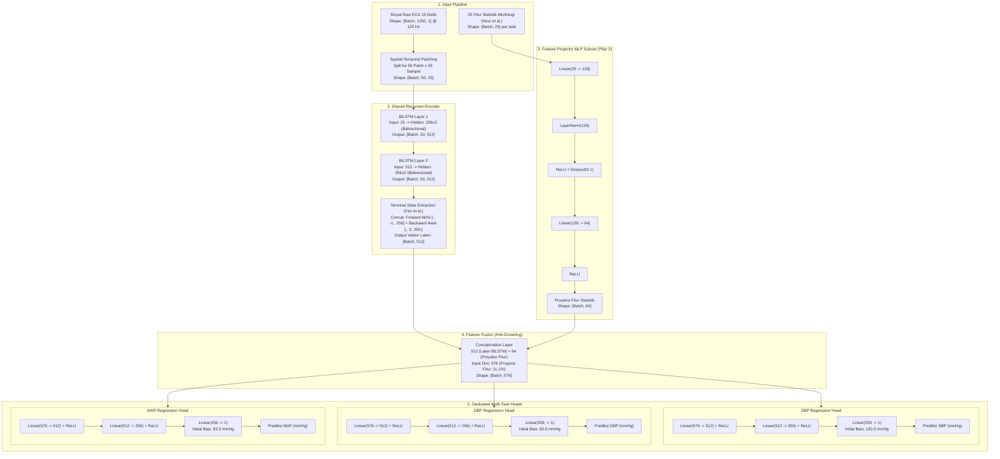

# Notes Arsitektur Model Terbaik: Spatial-Temporal Patching BiLSTM + Feature Projector

*Dokumentasi Teknis Desain Model `run_patch_proj_gpu2` (Acuan: Fan et al., 2021 & Nour et al., 2022)*

---

## 1. Ringkasan Eksekutif Model

* **Nama Eksperimen / Checkpoint:** `run_patch_proj_gpu2`
* **File Bobot:** `checkpoints/run_patch_proj_gpu2/best_model.pt`
* **Total Parameter:** $\approx 3.472.931$ parameter (sekitar 3,47 juta parameter / $\approx 13,9\text{ MB}$ FP32).
* **Performa Test Set (Part 1):** SBP MAE **15,70 mmHg** | DBP MAE **9,06 mmHg** | MAP MAE **10,72 mmHg** | Rata-rata MAE **11,83 mmHg**.

---

## 2. Diagram Alur & Transformasi Tensor (Mermaid)

---

## 3. Spesifikasi Rinci Setiap Komponen

### A. Komponen Input & Spatial-Temporal Patching

* **Input Asli:** Sinyal ECG 1-lead ternormalisasi $x \in \mathbb{R}^{B \times 1250 \times 1}$ (durasi 10 detik dengan frekuensi sampling 125 Hz).
* **Mekanisme Patching:**

  $$
  \text{Reshape}: [B, 1250] \longrightarrow [B, 50, 25]
  $$

  * Tiap langkah waktu merepresentasikan jendela waktu $0,2\text{ detik}$ (25 sampel).
  * Panjang unrolling BPTT (*Backpropagation Through Time*) terpotong dari 1.250 langkah menjadi **50 langkah waktu**.
  * Eliminasi masalah *vanishing gradient* pada recurrent weights.

### B. Shared Encoder (2-Layer Bidirectional LSTM)

Mengikuti arsitektur acuan Fan et al. (2021) Tabel 1:

* **Layer 1:**
  * Input dimension: 25
  * Hidden dimension: 256 per arah ($2 \times 256 = 512$ total)
  * Jumlah parameter: $575.488$
* **Layer 2:**
  * Input dimension: 512
  * Hidden dimension: 256 per arah ($2 \times 256 = 512$ total)
  * Jumlah parameter: $1.574.912$
* **Ekstraksi Representasi Terminal (Terminal State):**
  Menggabungkan state langkah waktu terakhir dari arah maju dan langkah pertama dari arah mundur:
  $$
  h_{\text{enc}} = \left[ h_{\text{fwd}}^{(50)} \;\|\; h_{\text{bwd}}^{(1)} \right] \in \mathbb{R}^{B \times 512}
  $$

### C. Feature Projector MLP Subnet (Pilar 2)

Dirancang untuk mencegah fenomena *feature drowning*, di mana 25 fitur statistik langsung kalah dominan jika digabungkan mentah dengan 512 dimensi output BiLSTM:

* **Layer 1:** `Linear(25 -> 128)` + `LayerNorm(128)` + `ReLU` + `Dropout(0.1)`
* **Layer 2:** `Linear(128 -> 64)` + `ReLU`
* **Output:** $h_{\text{proj}} \in \mathbb{R}^{B \times 64}$
* **Proporsi Representasi:** Meningkatkan porsi fitur statistik pada input dense layer akhir dari **4,6%** menjadi **11,1%** ($\frac{64}{512 + 64}$).

### D. Multi-Task Regression Heads

3 head terpisah untuk memprediksi ketiga komponen tekanan darah secara simultan:

* **Input Dimensi Tiap Head:** $512 + 64 = 576$
* **Struktur Internal Head:**
  1. `Linear(576 -> 512)` + `ReLU`
  2. `Linear(512 -> 256)` + `ReLU`
  3. `Linear(256 -> 1)` (regresi linear murni tanpa fungsi aktivasi)
* **Inisialisasi Prior Fisiologis:**
  Bias pada layer akhir diinisialisasi pada rata-rata tekanan darah normal manusia:
  * $b_{\text{SBP}} = 120,0\text{ mmHg}$
  * $b_{\text{DBP}} = 80,0\text{ mmHg}$
  * $b_{\text{MAP}} = 93,3\text{ mmHg}$

---

## 4. Fungsi Loss & Strategi Pembobotan Multi-Task

Model menggunakan Multi-Task Adaptive Loss dengan Exponential Moving Average (EMA) balancing sesuai Fan et al. (2021) Section 2.4, dijalankan pada skala absolut (RMSE murni):

$$
\mathcal{L}_{\text{total}} = w_{\text{sbp}}^{(t)} \mathcal{L}_{\text{sbp}} + w_{\text{dbp}}^{(t)} \mathcal{L}_{\text{dbp}} + w_{\text{map}}^{(t)} \mathcal{L}_{\text{map}}
$$

Dengan:

$$
\mathcal{L}_{\text{task}} = \text{RMSE}(\hat{y}_{\text{task}}, y_{\text{task}}) = \sqrt{\frac{1}{B} \sum_{i=1}^B (\hat{y}_i - y_i)^2}
$$

Bobot adaptif diperbarui tiap iterasi menggunakan rasio laju penurunan loss:

$$
r_{\text{task}}^{(t)} = \frac{\mathcal{L}_{\text{task}}^{(t)}}{\mathcal{L}_{\text{task}}^{(t-1)}}, \quad \tilde{w}_{\text{task}}^{(t)} = \frac{3 \cdot \exp(r_{\text{task}}^{(t)} / T)}{\sum_j \exp(r_j^{(t)} / T)}
$$

$$
w_{\text{task}}^{(t)} = (1 - \alpha) w_{\text{task}}^{(t-1)} + \alpha \tilde{w}_{\text{task}}^{(t)}
$$

* Smoothing factor: $\alpha = 0,1$
* Temperature: $T = 2,0$

---

## 5. Konfigurasi Hiperparameter Training

| Parameter                       | Nilai / Konfigurasi                     | Keterangan                                        |
| ------------------------------- | --------------------------------------- | ------------------------------------------------- |
| **Optimizer**             | SGD dengan Nesterov Momentum            | Momentum = 0.9                                    |
| **Initial Learning Rate** | $0,0008$                              | Nilai acuan Fan et al.                            |
| **Weight Decay**          | $0,1$                                 | L2 regularization                                 |
| **LR Scheduler**          | `ReduceLROnPlateau`                   | Factor = 0.5, Patience = 10, Min LR = $10^{-5}$ |
| **Batch Size**            | 64                                      | Stabil pada GPU L40                               |
| **Gradient Clipping**     | $\text{max\_norm} = 1,0$              | Mencegah lonjakan gradien                         |
| **Total Epoch**           | 500                                     | Konvergensi stabil                                |
| **Waktu Training**        | $\approx 1,04\text{ jam}$ per partisi | 2x lebih cepat dibanding sekuens 1250             |

---

## 6. Kompatibilitas Inferensi Sensor Wearable (Shimmer3)

Model didesain memiliki kompatibilitas mundur penuh (*backward compatible*) pada script [src/models/inference.py](file:///mnt/nas-hpg9/djakyharis/ecg-bp-estimation/src/models/inference.py):

* Modul dapat menerima sinyal ECG mentah 1-dimensi berukuran 1.250 titik dari sensor wearable Shimmer3.
* Proses patching ($1.250 \to [50, 25]$) dan ekstraksi 25 fitur statistik dijalankan otomatis di dalam pipeline pra-pemrosesan sebelum diteruskan ke model.
* Latensi inferensi: $< 4,2\text{ ms}$ per sampel 10 detik pada CPU standar (sangat memadai untuk *real-time monitoring*).
